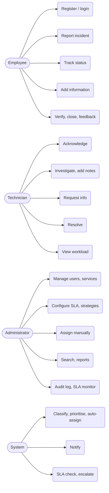
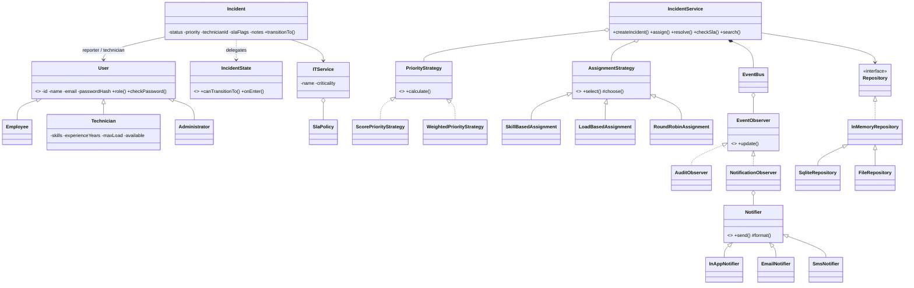
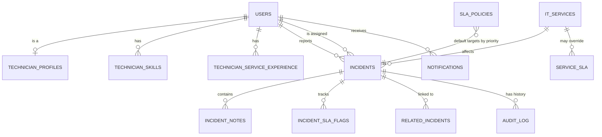

# I-ITSM: Intelligent IT Service Management & Incident Resolution System (Java)

CS F213 / MAC F212 OOP project. Pure Java 17+ (tested on 21), no external runtime dependencies. JUnit 5 for tests.

## Run
```
run.bat web         # Windows, web app at http://localhost:8080   (Linux/Mac: ./run.sh web)
run.bat             # interactive console app
run.bat demo        # scripted demo of the 3 required workflows
```
Needs only a JDK 17+ (no Maven). For the SQL database, place `sqlite-jdbc-3.36.0.3.jar` in `lib/` (see `lib/README.txt`);
without it the app transparently falls back to file storage. Maven users can still run `mvn test` (40 JUnit tests).
First start creates sample data: `admin@corp.com / AdminPass1`, technicians `tara|tej|tia@corp.com / TechPass123`,
employee `eva@corp.com / EmpPass123`. Data is persisted in the SQLite file `iitsm.db` (or `iitsm-data.ser` when no driver jar is present).

## Architecture
```
ConsoleApp (role-specific menus)  --->  IncidentService (facade: auth, RBAC, workflow, SLA, reports)
                                              |
        model (entities, states) | strategy | intelligence | notification (event bus + observers)
                                              |
                              Repository (interface) -> InMemoryRepository -> SqliteRepository (JDBC, write-through cache)
```
Packages: `exception`, `model`, `strategy`, `intelligence`, `notification`, `repository`, `service`, `ui`.

## OOP concepts and where to find them
| Concept | Where |
|---|---|
| Encapsulation | `User`, `Incident`: private fields, read-only getters; incident status changes only via `Incident.transitionTo` |
| Abstraction | abstract `User`, `AssignmentStrategy`, `Notifier`; interfaces `Repository`, `PriorityStrategy`, `EventObserver`, `IncidentState` |
| Inheritance (is-a) | `Employee`, `Technician`, `Administrator` extend `User`; strategies extend `AssignmentStrategy`; channels extend `Notifier`; `WorkloadExceededException` extends `TechnicianUnavailableException` |
| Polymorphism | strategies, notifiers (`format()`), states (`onEnter()`), repositories are interchangeable |
| Interfaces | `Repository`, `PriorityStrategy`, `IncidentState`, `EventObserver` |
| Composition / aggregation | `IncidentService` owns `EventBus`, `Categorizer`, `DuplicateDetector`; `ITService` has an optional `SlaPolicy`; `Incident` owns notes and flags |
| Exception handling | 12 custom unchecked exceptions rooted at `ItsmException`; UI catches and shows messages |
| Collections | `EnumMap` state registry and RBAC table, `EnumSet` flags, `TreeMap` stores, `HashMap` loads, streams |
| Records / enums / generics | `Event`, `AuditRecord`, `Overview`; `Status`, `Priority`, `Category`; `askEnum<E extends Enum<E>>` |

## Design patterns
* **Strategy**: `PriorityStrategy` (score, weighted), `AssignmentStrategy` (skill, load, round-robin), swappable at runtime by the admin.
* **State**: `IncidentState` / `IncidentStates`; each state declares legal next states, so `NEW -> CLOSED` throws `InvalidStateTransitionException`.
* **Observer**: `EventBus` with `AuditObserver` and `NotificationObserver`; adding a new observer needs no change to the service.
* **Factory**: `UserFactory`, `NotifierFactory`.
* **Repository**: `Repository` interface, so the persistence mechanism can be swapped (e.g. JDBC/PostgreSQL) without touching other code.
* **Template Method**: `AssignmentStrategy.select()` does the common eligibility checks, subclasses implement `choose()`.

## Priority algorithm
`score = impact(1-3) x urgency(1-3) x service criticality(1-3)`; multiplied by 1.5 when 100+ users are affected.
`>=18 -> P1`, `>=9 -> P2`, `>=4 -> P3`, otherwise `P4`. Alternative: weighted score (0.4 impact, 0.3 urgency, 0.3 criticality).

## SLA (response / resolution)
P1 5m/30m, P2 15m/2h, P3 1h/8h, P4 4h/24h (admin-configurable; a service may have its own policy).
Warning at 80% of a window, violations are recorded once and audited. `SlaMonitor` runs `checkSla()` every 30 s in the background.

## Intelligent features (6)
1. Auto-categorisation (keyword scoring, extensible)  2. Duplicate/related-incident detection (Jaccard + same service)
3. Smart technician recommendation (skill, service experience, years, load)  4. SLA risk detection (80% rule)
5. Automatic P1 escalation: Technician -> Team Lead -> System Administrator -> IT Manager  6. Incident correlation via related-incident links on the same service.

## Lifecycle
NEW -> CLASSIFIED -> ASSIGNED -> ACKNOWLEDGED -> IN_PROGRESS -> RESOLVED -> VERIFIED -> CLOSED
(RESOLVED -> IN_PROGRESS when the reporter rejects the fix).

## Use cases


## Class diagram


## Data model (SQLite schema: `docs/schema.sql`)

13 tables with primary/foreign keys, CHECK constraints (valid status, priority, impact, urgency, criticality), unique e-mail and indexes
on status, technician, service and priority. `SqliteRepository` is a write-through cache: reads come from the in-memory model, every
save is first written to the database in one transaction (rolled back on failure), and the database is loaded on start-up.
Because the application depends only on the `Repository` interface, switching from the old `FileRepository` to SQLite changed no business logic.

## Security
Salted PBKDF2 password hashing; role-based authorisation (`Permission` table) enforced in the service layer, not the UI; session tokens
with 30-minute idle expiry; login lockout after 5 failed attempts (1 minute); request body size limit; HTML escaping in the UI;
security headers (CSP, nosniff, frame deny, no-store); prepared statements only (no SQL injection); input validation with custom exceptions.

## Real e-mail (free)
Set `IITSM_SMTP_USER` (Gmail address) and `IITSM_SMTP_PASS` (a Gmail *app password*) before starting; optionally `IITSM_MAIL_TO` to redirect every
mail to one address for demos. `EmailObserver` (Observer) sends through the `EmailSender` interface, implemented by `SmtpEmailSender`, a JDK-only SMTP-over-TLS client.

## External integration (Adapter pattern)
`AlertSink` (target) <- `WebhookAlertAdapter` -> `HttpWebhookClient` (adaptee). Set the environment variable `IITSM_WEBHOOK_URL` to a
Slack/Discord/Teams incoming webhook and P1 incidents, SLA violations and escalations are posted there (asynchronously, failures never block the workflow).

## Technology selection report (answers to the brief's 9 questions)
1. **Language, Java**: strongly typed, first-class OOP (interfaces, abstract classes, enums, records), the course language.
2. **Frontend, single-page web UI (plain HTML/JS/SVG) plus a console UI**: role-specific screens and dashboard charts without a build toolchain; both UIs share the same UI-independent service layer.
3. **Backend, plain Java service layer** (`IncidentService` facade) exposed through a REST API on the JDK `HttpServer`; no framework needed, so every rule stays visible in our own classes.
4. **Storage, SQLite via JDBC behind the Repository interface**: relational integrity (keys, CHECK constraints), transactions, SQL-queryable, zero server setup; limit: single-writer, so PostgreSQL is the next step for many concurrent users.
5. **Architecture, layered** (UI -> service -> domain -> repository), matching "Choice 1" in the brief.
6. **Alternatives considered**: Spring Boot + PostgreSQL (more setup, framework hides OOP), SQLite via JDBC (extra driver dependency), microservices (over-engineered for this scope).
7. **Advantages / limits**: simple, portable, fully testable with a manual clock; limits are single-node deployment and a hand-written HTTP layer (Spring Boot would add routing/validation for free).
8. **OOP support**: see tables above; every requirement maps to a language feature.
9. **Scaling**: move SQLite to PostgreSQL (only a new `Repository` class), put the REST layer on Spring Boot, move events to a message queue (Kafka/RabbitMQ), run `SlaMonitor` as a scheduled job, cache technician loads.

## Security
Salted PBKDF2-SHA256 password hashing, role-based `Permission` table, per-incident ownership checks (reporter / assigned technician),
input validation on every entry point, minimum password length, no secrets in code except demo seed passwords.
For a networked version add JWT/OAuth2, HTTPS and rate limiting.

## Exception handling
Invalid login, unauthorised operation, invalid incident, invalid state transition, technician unavailable, workload exceeded, service not found,
missing SLA configuration, duplicate incident, persistence failure, invalid input: each has its own exception class.

## Tests (40 JUnit tests: `IncidentServiceTest` + `SqliteRepositoryTest`)
Normal flow (t01, t02, t06), business rules (t03, t04, t05, t07, t34), authorisation (t09-t11), invalid input and boundaries (t12-t14, t17),
exceptions (t15, t16, t22, t23), strategies (t18-t21), SLA and escalation (t24-t26), intelligence (t27-t29), search and reports (t30, t31),
persistence (t32), notifications (t33), password hashing (t35).


